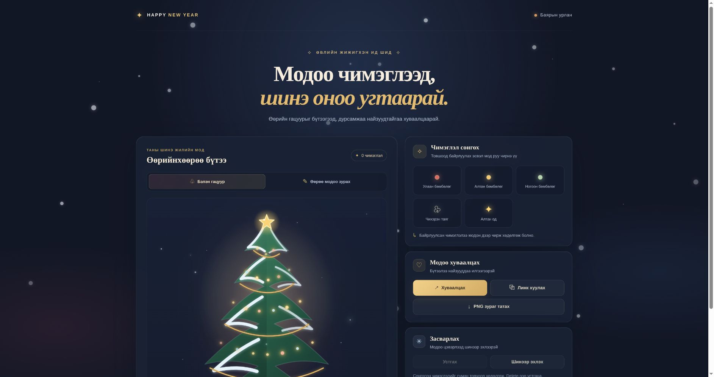

# Happy New Year — гацуур бүтээгч

Монгол хэлтэй, утсанд тохирсон шинэ жилийн урлан. Бэлэн гацуурыг чимэглэх эсвэл модоо өөрөө зурж, хувийн линк болон PNG зураг болгон хуваалцаарай.



## Локал хөгжүүлэлт

```bash
npm ci
npm run dev
```

Шалгалт ба production build:

```bash
npm test -- --run
npm run build
```

## Хэрхэн тоглох вэ

- Чимэглэлээ товшоод модон дээр дарж байрлуулна, эсвэл палитраас мод руу чирж тавина.
- Байрлуулсан чимэглэлийг mouse эсвэл touch-оор чирж хөдөлгөнө.
- **Өөрөө модоо зурах** горимд сойзны өнгө, хэмжээг сонгоод модны хэлбэрээ зурна. Баллуур, буцаах, бүх зураасыг арилгах хэрэгсэлтэй.
- Keyboard ашиглахдаа гацуурын зураг дээр фокус аваад `Enter` дарж байрлуулна. Чимэглэл дээр `Enter` дарж сонгох, суман товчоор хөдөлгөх, `Delete`-ээр устгах боломжтой.
- **Хуваалцах** товч төхөөрөмжийн share цонхыг нээнэ; дэмжигдээгүй бол линкийг clipboard руу хуулна. **Линк хуулах** нь share цонх нээлгүйгээр URL-ийг шууд хуулна. Clipboard ажиллахгүй үед линкийг сонгон гараар хуулах талбар гарна.
- **PNG зураг татах** товч мод болон чимэглэлийг зураг болгон хадгална.
- Модны хэлбэр, зурсан зураас, чимэглэл URL-ийн fragment-д хувилбартайгаар хадгалагддаг. Өмнөх хувилбарын линкүүд нээгдсээр байна. Backend шаардлагагүй. Буруу линк бол шинэ мод нээнэ.

## Vercel ба GitHub Actions

Vercel project нь `enkush-3/happy-new-year` репозитортой холбогдсон. Pull request/branch бүрт preview, `main` дээр production deploy гарна. Vercel-ийн **Deployment Checks** нь GitHub Actions-ийн `Tests and build` check-ийг production-д шаардаж, шалгалт амжилттай болсны дараа deploy-ийг promote хийнэ.

`.github/workflows/ci.yml` нь pull request болон `main` push дээр lockfile-оос суулгаж, тест ба build ажиллуулна. Actions-д Vercel token хадгалах шаардлагагүй; deploy-ийг Vercel-ийн GitHub integration хийнэ.
